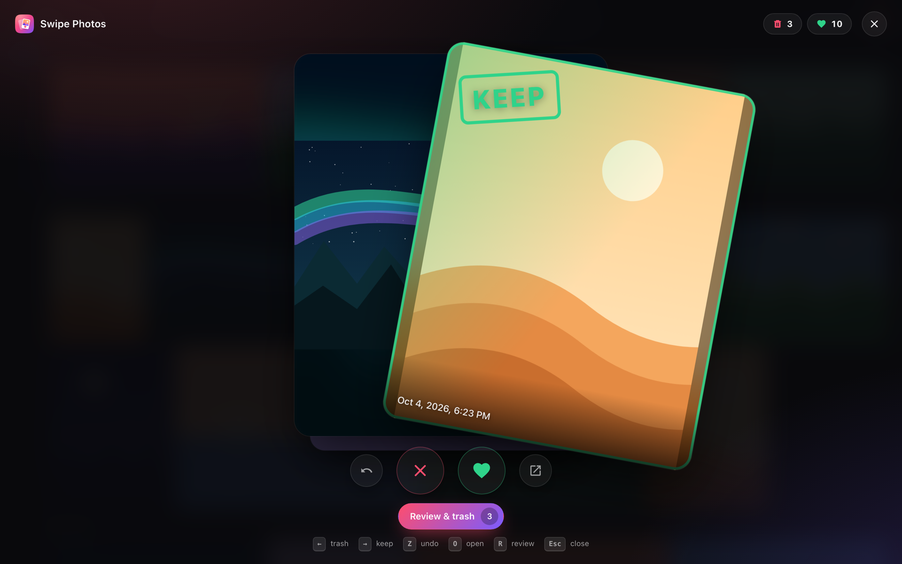
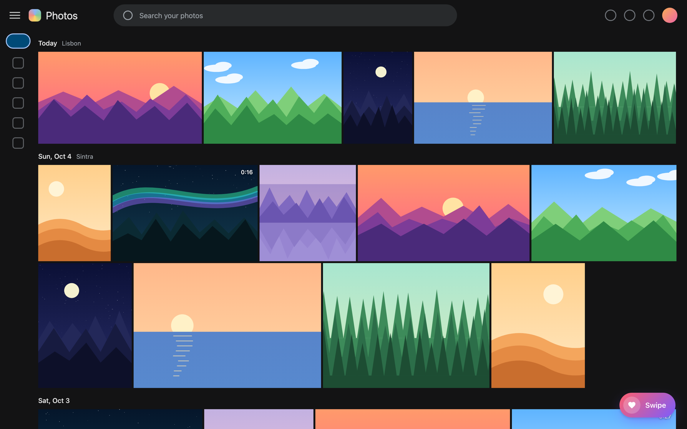
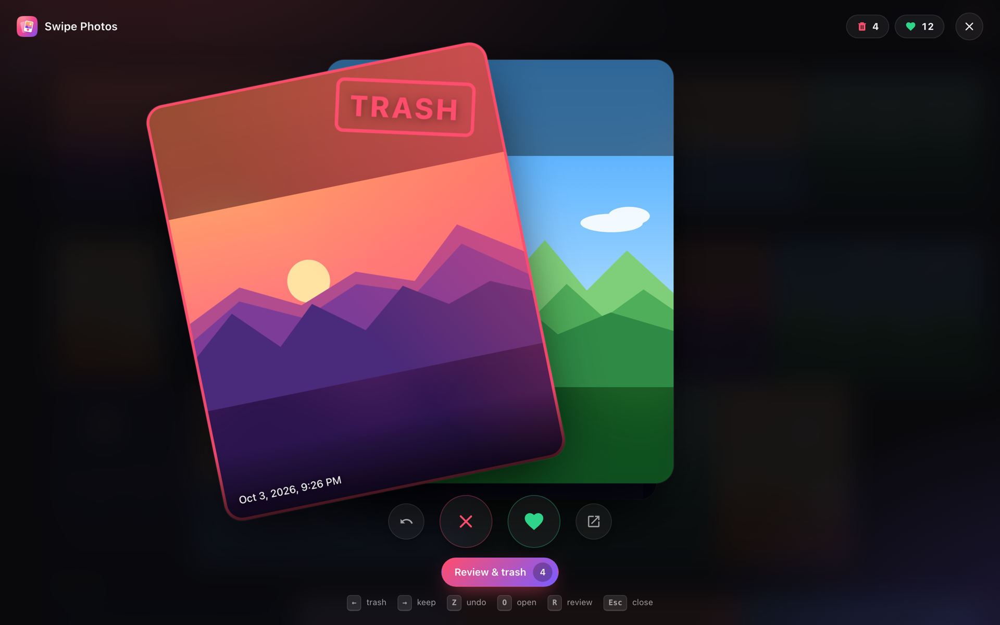
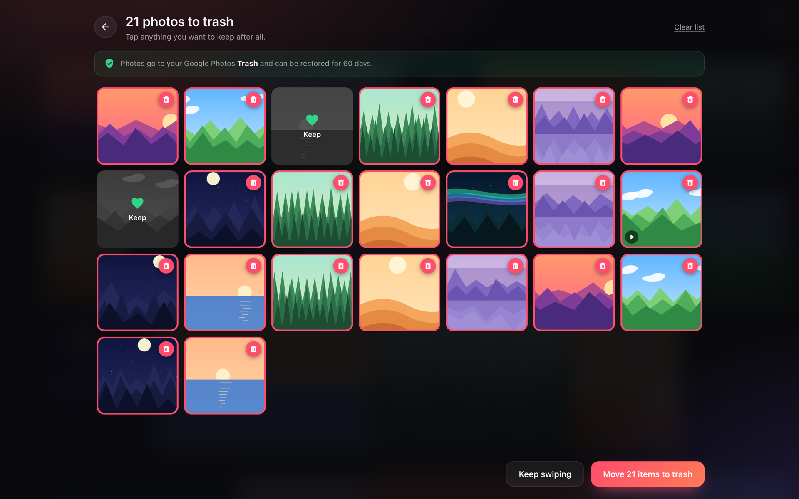
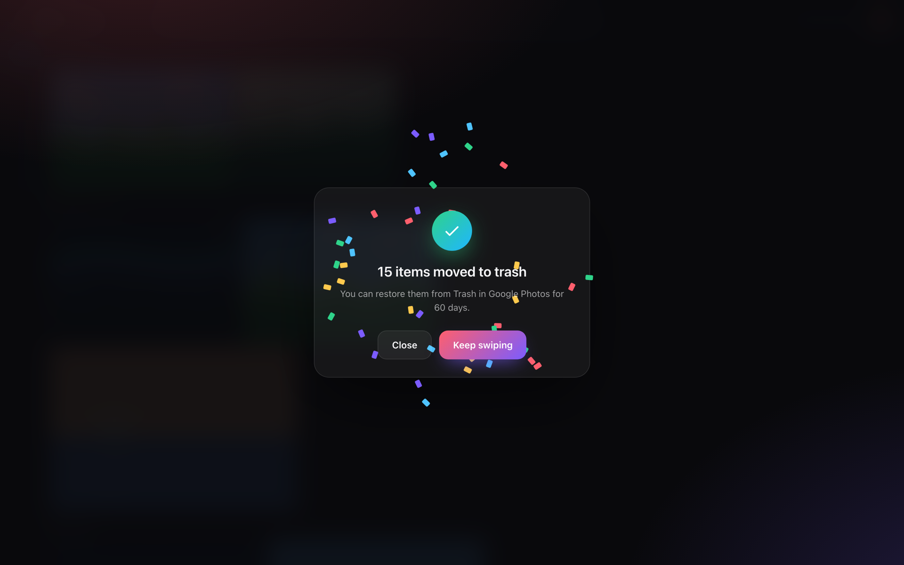
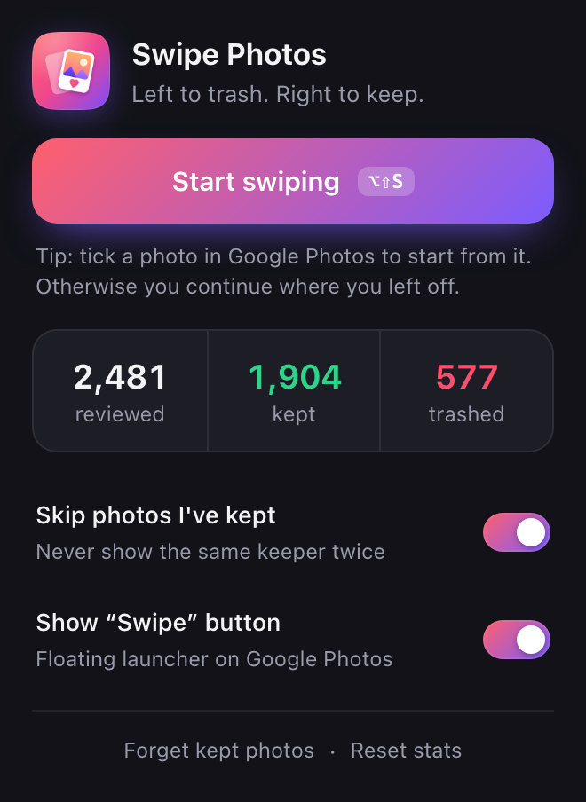

# Swipe Photos

[](https://klppl.github.io/lagom-license/)

Swipe to clean up Google Photos: **swipe left to trash, right to keep.**



## What it looks like

A **Swipe** button appears on Google Photos. Click it to start.



Drag a photo left to mark it for the trash, or right to keep it. You can also use a two-finger trackpad swipe or the arrow keys.



Nothing is deleted while you swipe. When you're ready, **Review & trash** shows everything you marked. Tap a photo to change your mind.



Confirming moves them to Google Photos **Trash**, where you can still restore them for 60 days.



The toolbar popup shows your stats and settings.



<sub>Screenshots show the real extension running on a demo photo library.</sub>

## Install

**Chrome Web Store:** _coming soon_

**Download:** [swipe-photos-latest.zip](https://github.com/klppl/swipe-cleanup-google-photos/releases/latest/download/swipe-photos-latest.zip), then follow the Developer mode steps below with the unzipped folder.

### Developer mode

1. Open `chrome://extensions` and switch on **Developer mode** (top right).
2. Click **Load unpacked** and pick this repository folder, or a folder you unzipped a packaged build into (see below).
3. Open [photos.google.com](https://photos.google.com) and click the **Swipe** button (bottom right) or the toolbar icon.

### Safari (macOS)

Safari loads extensions from inside a Mac app, so you build that app with Xcode. The project in `safari/` uses the same extension files as Chrome, so nothing is copied.

1. Open `safari/Swipe Photos/Swipe Photos.xcodeproj` in Xcode.
2. Pick a signing team: select the **Swipe Photos** project, then for both the **Swipe Photos** and **Swipe Photos Extension** targets go to **Signing & Capabilities** and choose your team. A free personal team (your Apple ID) is enough for your own Mac.
3. Choose **Product → Run**. This builds the app and opens it once, which registers the extension with Safari.
4. In Safari, open **Settings → Extensions**, turn on **Swipe Photos**, and allow it on photos.google.com.
5. Open [photos.google.com](https://photos.google.com) and use the **Swipe** button or the toolbar icon.

If you build without a signing team, Safari only loads the extension after you turn on **Settings → Advanced → Show features for web developers**, then **Develop → Allow Unsigned Extensions**. Safari turns that setting off again each time it quits.

After you edit the extension files, run the app from Xcode again so Safari picks up the changes.

### Packaging the extension

To build the zip without cloning anything, open the repository's **Actions** tab, choose **Package**, and click **Run workflow**. When the run finishes, download the `swipe-photos-<version>` artifact at the bottom of the run page. That download is the zip to upload to the Chrome Web Store. Unzip it to get a folder you can load with **Load unpacked**.

To build it locally, run `./scripts/package.sh`. It writes `dist/swipe-photos-<version>.zip`.

To publish a build for others to download, run the **Release** workflow the same way. It replaces `swipe-photos-latest.zip` on the single `latest` release, so the download link above always points to the newest build.

## How it works

- **Choosing where to start:** tick a photo in Google Photos and then open Swipe to start from that photo. If you scrolled the grid to some date, it starts at the first photo on screen. If the grid is at the top, it continues after the last photo you kept, with a **Start from top** button in case you want to begin again.
- Photos you swipe left go on a **trash list**. Nothing is deleted until you open **Review & trash** and confirm.
- In review, tap any photo to keep it after all. Confirming selects the photos in Google Photos and moves them to **Trash**, where you can restore them for 60 days.
- Photos you keep are remembered (per Google account) and skipped next time. You can turn this off in the popup.
- Your trash list survives closing the tab.
- To start over, use **Reset everything** in the toolbar popup. It clears the trash list, kept photos, stats and settings, and changes nothing in Google Photos.

| Action | Mouse / trackpad | Keyboard |
| --- | --- | --- |
| Trash | drag or two-finger swipe left, ✕ button | `←` / `A` |
| Keep | drag or two-finger swipe right, ♥ button | `→` / `D` |
| Undo | ↺ button | `Z` / `Backspace` / `⌘Z` |
| Open in Google Photos (play videos) | ↗ button | `O` / `↑` |
| Review & trash | bottom button | `R` / `Enter` |
| Close | ✕ top right | `Esc` |

## Project layout

```
manifest.json
content/photos-dom.js   all Google Photos DOM access (scan grid, scroll, select, trash)
content/swipe-ui.js     the swipe app: state, persistence, overlay UI (shadow DOM)
content/content.js      bootstrap: floating button, messages, auto-start
content/swipe.css       overlay + launcher styles
popup/                  toolbar popup: start, stats, settings
safari/                 Xcode project that wraps the extension for Safari on macOS
```

If Google changes its markup, `content/photos-dom.js` is the only file that should need fixing.

## Privacy

Everything stays in your browser: no servers, no analytics, no ads. The extension only runs on photos.google.com and stores its data in `chrome.storage.local`. See [PRIVACY.md](PRIVACY.md).

## License

[The Lagom License](LICENSE) (v2): use, change and share it freely; just keep the copyright line and the license with it. Swipe Photos is not affiliated with or endorsed by Google. Google Photos is a trademark of Google LLC.
